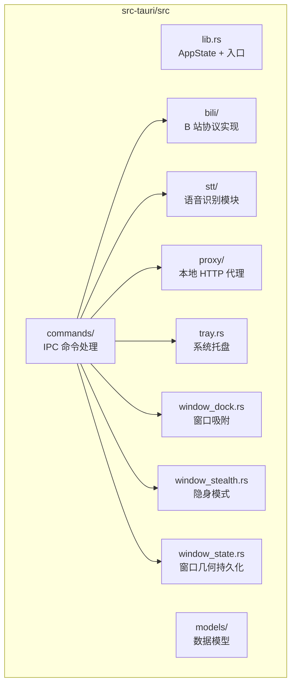
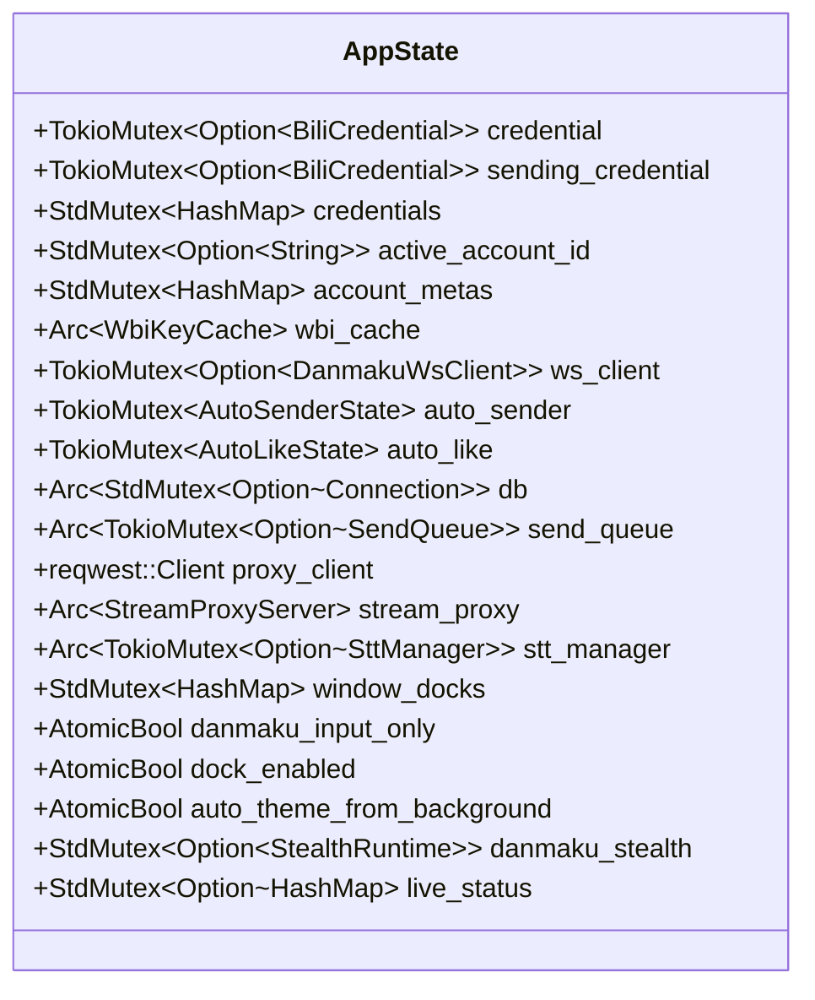

# 后端架构

BiliDanmu 的后端基于 **Rust** 构建，通过 Tauri 提供 IPC 命令与事件机制与前端通信。

## 技术选型

| 领域 | 技术 | 说明 |
| --- | --- | --- |
| HTTP 客户端 | reqwest 0.12 | 调用 B 站 API（rustls） |
| WebSocket | tokio-tungstenite 0.24 | 实时弹幕连接 |
| 压缩 | brotli, flate2 | 处理 B 站压缩响应 |
| 音频解码 | symphonia 0.6 | AAC 解码（用于 STT） |
| 语音识别 | sherpa-onnx 1.13 | 流式语音识别 |
| 数据库 | rusqlite 0.31（bundled） | SQLite 操作 |
| 代理 | hyper 1.x + hyper-util | 本地 HTTP 代理（直播流 / 视频流） |
| 异步运行时 | tokio | 异步任务调度 |
| 签名 | sha2 / sha3 / blake2 / md-5 | WBI 与登录签名 |

## 模块划分

### B 站协议 (`src/bili/`)

| 文件 | 说明 |
| --- | --- |
| `credential.rs` | Cookie 解析、SESSDATA 百分比编码、发送前校验 |
| `wbi.rs` | WBI 签名（MIXIN_KEY_ENC_TAB + MD5）、密钥缓存 |
| `protocol.rs` | 16 字节大端序包头、Brotli/zlib 解压、消息解析分发 |
| `pb.rs` | 最小 protobuf wire 解码器，用于 `SEND_GIFT_V2` |
| `ws_client.rs` | WebSocket 客户端（认证、心跳、服务器优选、自动重连） |
| `api.rs` | `BiliApiClient`：房间、视频、评论、表情、礼物等接口 |
| `heartbeat.rs` | Web / 移动端观看心跳上报 |
| `buvid.rs` | 随机 hex + 时间戳生成 buvid3/buvid4 |
| `mock.rs` | 虚拟直播间：本地弹幕服务器（23330）+ HTTP 控制面（23331） |

### IPC 命令 (`src/commands/`)

每个命令对应前端可调用的一个函数，按领域划分：

| 模块 | 说明 |
| --- | --- |
| `auth.rs` | 账号登录（TV 二维码 / Cookie）、切换、刷新、匿名模式 |
| `room.rs` | 房间搜索、添加、移除、排序、表情、音频流、弹幕窗创建与切房、仅输入框模式、亮度采样 |
| `danmaku.rs` | 弹幕发送、表情发送、点赞、循环发送、自动点赞 |
| `gift.rs` | 礼物面板、背包、余额、发送（`gift-send` feature 门控） |
| `video.rs` | 视频信息、音轨、字幕、收藏夹、稍后再看、搜索、评论 |
| `websocket.rs` | 弹幕流连接与断开 |
| `settings.rs` | 设置读写、STT 可用性 |
| `selections.rs` | 轻量选项持久化（`app_metadata` 键值） |
| `message_template.rs` | 快捷消息模板 CRUD |
| `proxy.rs` | 图片代理与缓存统计/清理 |
| `stt.rs` | 语音识别启停、模型枚举与目录 |
| `update.rs` | 更新检查 |
| `download.rs` | 安装包下载与打开文件 |
| `log.rs` | 打开日志目录 |

### 数据模型 (`src/models/`)

| 文件 | 说明 |
| --- | --- |
| `account.rs` | 账号与登录状态 |
| `room.rs` | 房间、房间信息、开播状态 |
| `message.rs` | `DanmakuEvent`、`Medal` |
| `settings.rs` | 全部设置结构（含 `PriceColors`、`TitleBarButtons`、`DanmakuWindowStyle`） |
| `stream.rs` | 直播流地址与 URL 列表 |
| `video.rs` | 视频、分 P、合集、字幕、评论、收藏夹、稍后再看 |
| `gift.rs` | 礼物配置、背包、钱包 |
| `response.rs` | B 站通用响应包装 |

所有结构体使用 `serde(rename_all = "camelCase")` 与前端类型对齐；设置类结构大量使用字段级 `#[serde(default)]`，保证旧持久化数据能读取。

### 语音识别 (`src/stt/`)

| 文件 | 说明 |
| --- | --- |
| `pipeline.rs` | 主流程：FLV 解复用 → AAC 解码 → 重采样 → sherpa-onnx 识别（跑在 `spawn_blocking`） |
| `flv_demux.rs` | FLV 解复用器，提取 AAC 帧，封装 ADTS 头 |
| `mod.rs` | `SttManager` 生命周期管理与 `stt-transcript` 事件发送 |

### 本地代理 (`src/proxy/stream_proxy.rs`)

- 基于 hyper 1.x 的 HTTP 代理，`OnceCell` 懒初始化、随机端口
- **双槽设计**：直播流与视频（VOD）流各占一个 URL 槽，互不抢占
- 字节流 tee 到 STT 管道（`stt_sender` 可在启停时热替换）

### 窗口与桌面集成

| 文件 | 职责 |
| --- | --- |
| `tray.rs` | 托盘图标、账号/直播间子菜单、左键切换当前窗口、完整退出清理 |
| `window_dock.rs` | 贴边吸附：光标轮询、收缩条几何、展开/收起/退出动画与事件 |
| `window_stealth.rs` | 隐身：光标轮询 + 点击穿透 + 显隐滞后 |
| `window_state.rs` | 弹幕窗口几何持久化（位置物理像素、尺寸逻辑像素、整对校验、屏内校验） |
| `shortcuts.rs` | 全局快捷键注册与动作分发 |
| `screen_luminance.rs` | GDI 截屏采样背景平均亮度（供「跟随背景亮暗」） |
| `focus.rs` | 唤起前记录前台窗口，隐藏时恢复焦点 |

### 存储层

| 文件 | 说明 |
| --- | --- |
| `db.rs` | 打开 `bilidanmu.db`、建表与迁移（WAL 模式） |
| `settings_store.rs` | 设置以 JSON 存在 `app_metadata` |
| `selections_store.rs` | 轻量键值（当前房间、收藏、视图模式、侧栏宽度） |
| `room_store.rs` | 房间表 + 开播时间回填 |
| `emoticon_store.rs` | 表情包 / 表情 / 收藏 |
| `message_template_store.rs` | 快捷消息 |
| `credential_store.rs` | 账号凭证（tauri-plugin-store 的 `credential.json`） |

## 应用状态

`AppState` 管理全局共享状态（`src/lib.rs`）：

## 插件与生命周期

注册的 Tauri 插件：`single-instance`（第二次启动唤起当前窗口）、`store`、`shell`、`opener`、`global-shortcut`、`log`（同时输出到 stdout / webview / 日志目录）。

`setup()` 依次：创建托盘 → 按需启动虚拟直播间 → 打开 SQLite → 注册全局快捷键 → 读取设置并决定主窗口显隐（含静默启动）→ 预加载荣耀等级图标 → 启动发送队列 → 拉起 60 秒开播状态轮询 → 恢复凭证 → 刷新托盘 → 后台刷新所有房间标题。

窗口事件：`main` 的 `CloseRequested` 阻止关闭改为隐藏；`danmaku` 的 `Resized`/`Moved` 走防抖几何持久化，`Destroyed` 清理吸附/隐身状态并通知主窗口 `room-exited`。

## 错误处理

- 命令统一返回 `Result<T, String>`，错误信息直接面向用户（中文）
- 关键路径用 `log` 记录（`tauri_plugin_log`，过滤掉 symphonia 的高噪声日志）
- 反序列化对未知枚举值做回退，避免单个坏字段导致整份设置加载失败

## 异步任务

- 使用 `tokio::spawn` 启动后台任务
- WebSocket 连接、循环发送、自动点赞、开播状态轮询均为独立异步任务，用 oneshot / Notify 取消
- STT 管道运行在 `spawn_blocking` 避免阻塞 tokio 运行时
- 发送走 `send_queue`，按 manual > ai > auto 的优先级排队并限速（最小间隔 1000ms）
