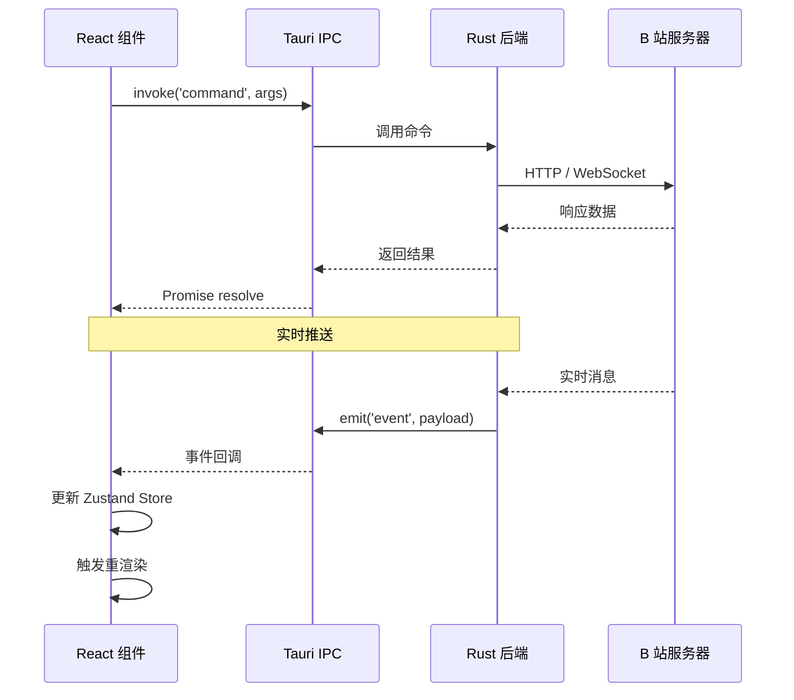
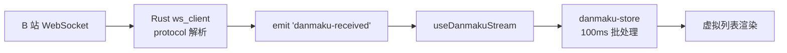
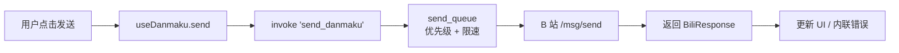
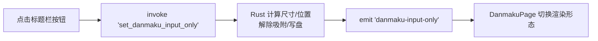

# 数据流设计

BiliDanmu 的数据流遵循 **单向数据流** 原则，前端通过 Tauri IPC 调用后端，后端通过事件（Event）向前端推送数据。

## 整体数据流



## 请求-响应模式

前端通过 `invoke` 调用后端命令，后端返回结果。实际代码统一走 `src/lib/tauri.ts` 的封装：

```typescript
import { tauriCommands } from '@/lib/tauri'

const rooms = await tauriCommands.room.search('test', 'name')
const status = await tauriCommands.room.getRoomsLiveStatus()
```

```rust
// 后端处理（commands/room.rs）
#[tauri::command]
pub async fn search_room(
    query: String,
    mode: String,
    state: State<'_, AppState>,
) -> Result<Vec<SearchRoomResult>, String> {
    // 按 mode 分支：roomId/link → get_room_info，uid → resolve_room_by_uid，name → 搜索
}
```

## 事件推送模式

后端通过 `app.emit` / `emit_to` 向前端推送实时数据：

```rust
// 后端发送事件
app_handle.emit("danmaku-received", danmaku_event)?;
// 只发给主窗口
window.app_handle().emit_to("main", "room-exited", 0u64)?;
```

```typescript
// 前端监听事件（useTauriEvent 是对 listen 的类型化封装）
import { listen } from '@tauri-apps/api/event'

await listen<DanmakuMessage>('danmaku-received', (event) => {
  const danmaku = event.payload
  // 更新状态
})
```

## 状态管理

前端使用 **Zustand** 管理全局状态：

| Store | 职责 |
| --- | --- |
| `auth` | 账号、登录状态 |
| `room` | 当前房间、房间列表、收藏、视图模式 |
| `danmaku` | 三栏消息列表、统计计数、屏蔽规则 |
| `settings` | 应用设置、背景主题覆盖 |
| `ui` | 侧栏宽度 |
| `video-audio` | 播放队列、当前曲目、播放模式 |

## 典型数据流示例

### 弹幕接收



`danmaku-store` 用一个 100ms 的批处理窗口合并写入，避免每条消息都触发一次 React 渲染；醒目留言的翻译补全会回填到已有条目（按 `roomId + id` 匹配）。

### 发送弹幕



循环发送与自动点赞走另一条路径：Rust 侧持有循环任务，按间隔 `emit` `auto-send-tick` / `auto-like-tick`，前端只做状态展示。

### 窗口模式切换



窗口几何、吸附、隐身这类状态以后端为准：前端先发起调用，再通过事件确认结果，不做乐观假设。

## 持久化

| 数据 | 存储方式 | 位置 |
| --- | --- | --- |
| 账号凭证 | tauri-plugin-store | 应用数据目录 `credential.json` |
| 应用设置 | SQLite `app_metadata`（key = `settings`） | `bilidanmu.db` |
| 轻量选项（当前房间、收藏、视图模式、侧栏宽度） | SQLite `app_metadata` | `bilidanmu.db` |
| 房间列表 | SQLite `rooms` 表 | `bilidanmu.db` |
| 表情包 / 表情 / 收藏 | SQLite `emoticon_packages` / `emoticons` / `favorite_emoticons` | `bilidanmu.db` |
| 图片缓存 | SQLite `image_cache` 表 | `bilidanmu.db` |
| 快捷消息 | SQLite `message_templates` 表 | `bilidanmu.db` |
| 弹幕窗口几何 | SQLite `app_metadata`（`selections_store`，key = 窗口几何） | `bilidanmu.db` |
| 界面缩放、分隔条比例、上次检查更新时间 | localStorage | WebView 本地存储 |
