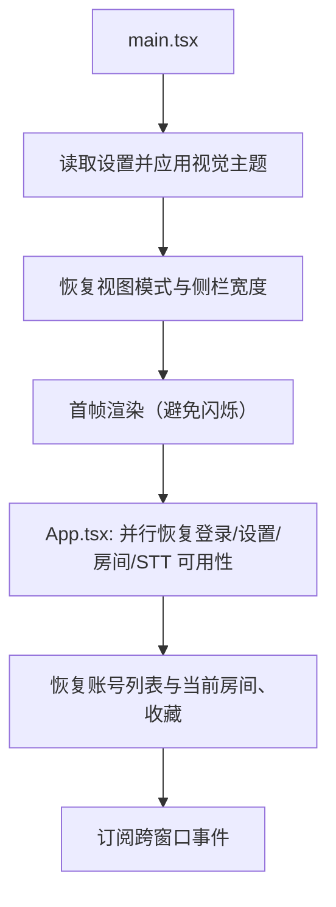

# 前端架构

BiliDanmu 的前端基于 **React 18 + TypeScript + Vite 7** 构建，采用组件化、Hooks 驱动的开发模式。

## 技术选型

| 领域 | 技术 | 说明 |
| --- | --- | --- |
| 框架 | React 18 | 函数组件 + Hooks |
| 语言 | TypeScript 5 | 类型安全 |
| 构建 | Vite 7 | 开发服务器固定 3000 端口，产物输出到 `dist/` |
| 路由 | React Router 7 | `createBrowserRouter` |
| 状态 | Zustand 5 | 轻量状态管理 |
| 样式 | TailwindCSS 3 | 原子化 CSS + CSS 变量语义 token |
| UI 组件 | Radix UI | 对话框、Tabs、Slider、Checkbox 等原语（自身封装，不是 shadcn CLI 生成） |
| 图标 | Lucide React | 统一图标库 |
| 通知 | Sonner | Toast 通知 |

> TanStack Query 已安装并在 `main.tsx` 挂了 `QueryClientProvider`，但当前没有页面真正使用 `useQuery`；数据请求仍以命令式 `await tauriCommands.*` + Zustand 为主。

## 启动流程

`App.tsx` 之后订阅的跨窗口事件：`room-switched`、`rooms-updated`、`account-switched`、`settings-changed`、`danmaku-entered`、`room-exited`。其中与视频/直播互斥相关的两个事件只在 `label === "main"` 的窗口里处理。

## 组件设计原则

1. **单一职责**：每个组件只负责一个功能
2. **组合优于继承**：通过组合实现复杂 UI
3. **Hooks 抽离逻辑**：业务逻辑放在 Hooks 中，组件只负责渲染
4. **类型安全**：所有组件与 Hooks 都有完整的 TypeScript 类型

## Hooks 设计

| Hook | 职责 |
| --- | --- |
| `useDanmakuStream` | 管理 WebSocket 连接与弹幕数据 |
| `useDanmaku` | 发送弹幕 / 表情 / 礼物的动作封装 |
| `useAutoSend` | 循环发送会话状态 |
| `useAutoLike` | 自动点赞会话状态 |
| `useAudioPlayer` | 直播音频播放、重连与音量 |
| `useSttTranscript` | 字幕缓冲、同步偏移与淡出 |
| `useTheme` | 主题应用与跟随系统 / 跟随背景 |
| `useBackgroundTheme` | 轮询屏幕亮度并写入主题覆盖 |
| `useTauriEvent` | Tauri 事件监听封装 |
| `useWindowDock` | 贴边吸附状态同步 |
| `useProxyImage` | 图片代理加载（L1 内存 + L2 SQLite） |
| `useUpdateCheck` | 24 小时一次的更新检查 |
| `useDividerDrag` | 可拖拽分隔条（弹幕窗三栏） |
| `useUiScale` | 整个界面缩放 |
| `useZoom` | 弹幕字号 Ctrl+滚轮 |
| `useInfiniteScroll` | 列表滚动加载 |
| `useReducedMotion` | 系统「减少动态效果」 |
| `useErrorCapture` | 全局错误与未处理 Promise 捕获 |
| `useAuth` / `useRoom` | 对 store 的薄封装（当前未被引用） |

## 状态管理

使用 **Zustand** 管理全局状态，每个领域一个 Store：

| Store | 职责 | 持久化 |
| --- | --- | --- |
| `auth-store` | 账号列表、当前账号、匿名标记 | 无（凭证在 Rust 侧） |
| `room-store` | 房间列表、当前房间、视图模式、收藏 | 房间在 SQLite，其余走 selections |
| `danmaku-store` | 三栏消息、统计计数、连接状态、屏蔽规则 | 无（内存，上限来自设置） |
| `settings-store` | 全部设置、STT 可用性、背景主题覆盖 | SQLite `app_metadata` |
| `ui-store` | 侧栏宽度 | selections |
| `video-audio-store` | 播放队列、当前曲目、播放模式、进度 | 无（单例 `<audio>`，会话内） |

设置改动后 `patchSettings` 会 `emit("settings-changed")` 通知其它窗口同步。

## IPC 封装

所有 Tauri IPC 调用统一封装在 `src/lib/tauri.ts` 的 `tauriCommands` 对象中，按命名空间组织：

| 命名空间 | 职责 |
| --- | --- |
| `auth` | 账号相关 |
| `room` | 房间、表情、音频流、仅输入框模式 |
| `danmaku` | 弹幕发送、循环发送、自动点赞 |
| `gift` | 礼物面板与发送（gift-send 构建） |
| `ws` | WebSocket 连接 |
| `video` | 视频信息、音频、收藏夹、字幕、评论 |
| `settings` | 设置与 STT 可用性、快捷键注册错误 |
| `state` | 房间列表查询 |
| `selections` | 轻量选项持久化 |
| `dock` | 贴边吸附 |
| `stealth` | 隐身模式 |
| `proxy` | 图片代理与缓存统计 |
| `stt` | 语音识别控制 |
| `messageTemplate` | 快捷消息 |
| `update` | 更新检查与下载 |
| `log` | 日志目录 |
| `app` | 退出应用 |

## 性能优化

- **虚拟列表**：三栏消息都使用 `@tanstack/react-virtual`，只渲染可视区域
- **消息批处理**：`danmaku-store` 以 100ms 窗口合并写入，避免每条消息触发一次渲染
- **消息行 memo**：`DanmakuMessageItem` 使用 `React.memo`
- **图片缓存**：代理结果在前端做 500 条内存 LRU，避免重复 IPC
- **useMemo / useCallback**：缓存筛选结果与事件回调

## 样式体系

- 颜色全部走 CSS 变量：`--brand-rgb`（强调色）、`--app-page` / `--app-surface` / `--app-sidebar`、`--ink` / `--ink-muted`、`--border-subtle`
- Tailwind 里映射为 `brand` / `app-page` / `app-surface` / `ink` / `ink-muted` / `border-subtle`
- 主题由 `visual-theme.ts` 在运行时写入 `:root`，所以强调色与配色可以即时预览
- `.window-rounded` 统一窗口圆角（8px），用 `clip-path` 裁掉子元素方角

## 类型定义

所有类型定义集中在 `src/types/` 目录：

| 文件 | 说明 |
| --- | --- |
| `bilibili.ts` | 房间、账号、表情、视频、评论、设置、快捷键、外观等类型 |
| `danmaku.ts` | 弹幕消息、内联表情、大表情、粉丝牌等类型 |
