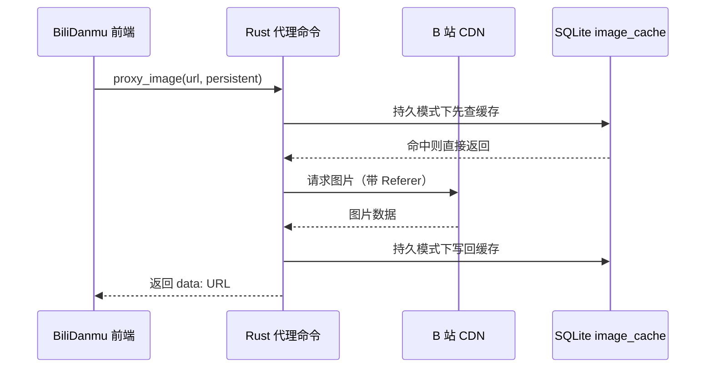

# 图片代理与缓存

BiliDanmu 内置图片代理与缓存机制，用于加载用户头像、表情、礼物图片与荣耀等级图标。

## 为什么需要代理

B 站图片 CDN 有 **Referer 防盗链** 限制，直接引用会返回 403。BiliDanmu 通过本地代理转发请求（带上 `Referer: https://live.bilibili.com/`），绕过该限制。

## 代理流程

注意代理返回的是 **base64 data URL**，不是本地 HTTP 地址。

## SSRF 防护

为防止服务器端请求伪造（SSRF），代理实现了两层限制：

- **协议限制**：只接受 `https://` / `http://`（以及内部的 `wealth-level://` 虚拟协议）
- **域名白名单**：只允许 `*.hdslb.com`、`hdslb.com`、`*.bilibili.com`、`bilibili.com`
- **体积上限**：单张图片最大 5MB，响应头与实体都会检查

## 两级缓存

| 层级 | 位置 | 说明 |
| --- | --- | --- |
| L1 | 前端内存 Map | 上限 500 条，先进先出淘汰，避免同一 URL 重复走 IPC |
| L2 | SQLite `image_cache` 表 | 仅在 `persistent = true` 时写入；封面、头像、表情包图片走这一层 |

弹幕表情与醒目留言头像这类临时图片只走 L1，避免数据库膨胀。`wealth-level://` 图标在应用启动时预加载进 SQLite。

## 缓存统计

`get_cache_stats` 返回当前占用：

| 字段 | 说明 |
| --- | --- |
| `imageCount` | 封面与头像缓存数量（不含表情与荣耀等级图标） |
| `imageSize` | 封面与头像缓存总字节数 |
| `emoticonPkgCount` | 表情包数量 |
| `emoticonCount` | 表情数量 |
| `emoticonImageSize` | 表情图片总字节数 |

对应「设置 → 存储 → 图片缓存」，可以分别清除封面/头像、表情，或一次清除全部。

## 表情数据缓存

除图片本身，BiliDanmu 还缓存表情包元数据：

- `emoticon_packages` / `room_emoticon_packages` / `emoticons`（按房间与账号关联）
- `favorite_emoticons`（按账号保存的收藏，含排序）
- 对应命令：`clear_emoticon_cache`（全部）、`clear_room_emoticon_cache`（指定房间）、`clear_room_specific_emoticons`（房间专属表情）
