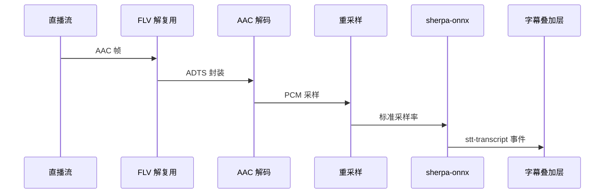

# 语音转字幕（STT）

BiliDanmu 内置基于 **sherpa-onnx** 的流式语音识别功能，可将直播音频实时转为字幕。

## 技术原理

## 使用方式

1. 进入「设置 → 直播音频」，在「实时字幕」中点击「下载模型」，从精选列表一键安装（自动下载、解压并放入模型目录，境内下载自动经镜像加速；也可打开官方模型页手动下载）。
2. 在「识别模型」下拉框选择模型，开启「启用语音识别」。
3. 进入直播间并播放直播音频，识别出的字幕会叠加在弹幕窗口底部。

看直播时想临时关掉字幕，不必回到主窗口：点弹幕窗口底栏的「设置」（齿轮图标），「外观设置」面板里的「实时字幕」开关就是同一项设置。关闭后识别立即停止、字幕同时消失；如果还没装模型，这个开关会置灰并提示去设置里安装。

手动安装（备选）：将模型放入模型目录，每个模型使用独立子文件夹，包含 encoder、decoder、joiner 的 ONNX 文件及 `tokens.txt`，放好后点击「刷新模型」。

字幕会按播放进度自动对齐（识别时间轴锚定到播放器进度上，暂停时字幕随之冻结）。一般无需手动调整；如实测仍有固定偏移，可微调「字幕同步偏移」：负值提前，正值延迟，步进 100ms，范围 −2000…+2000。

## 功能特点

- **本地推理**：基于 sherpa-onnx 2.0，无需联网，保护隐私
- **两种识别档位**（装哪个模型自动切哪档）：
  - **流式**：边说边出字，延迟最低——2025 年 zipformer 中文系列（标准/加大杯/CTC/超轻量）、8 语种、英文、含粤语的三语 Paraformer
  - **离线**：VAD 自动切句后整句识别，精度显著更高、延迟约 3–5 秒——SenseVoice、FunASR Nano（2025-12）、FireRedASR2 与 Qwen3-ASR（均 2026 年新模型）
- **字幕叠加**：字幕以叠加层形式显示在弹幕窗口，静音时淡出
- **播放对齐**：字幕按播放进度自动对齐，重连后自动重新锚定
- **在线下载**：设置页「下载模型」精选列表一键安装（境内自动镜像加速），离线模型自动附带 VAD
- **模型切换**：可列出模型目录下的多个子文件夹并切换
- **同步微调**：自动对齐之外仍可微调字幕同步偏移
- **按需开启**：可在设置中随时开启 / 关闭；STT 始终编译进程序，没有单独的精简构建

## 识别流程

识别管道跑在 `spawn_blocking` 线程里，不占用 tokio 运行时；字幕通过 `stt-transcript` 事件推送到前端，事件自带音频流内时间戳，前端按播放进度调度显示——识别快慢不再影响字幕与声音的对齐。

## 性能提示

- 语音识别会占用一定的 CPU 资源
- 如遇到性能问题，可尝试关闭其他占用 CPU 的应用
- 建议在较新的设备上启用此功能

## 常见问题

**Q：字幕和声音对不上？**

A：字幕按播放进度自动对齐；如仍有固定偏移，可用「字幕同步偏移」微调（负值提前、正值延迟）。识别速度慢于播放速度时字幕会滞后跟上，属正常现象。

**Q：识别准确率不高？**

A：准确率受音频质量、背景噪音等因素影响，建议在安静环境下使用，或切换更大型号。

**Q：虚拟直播间能用吗？**

A：不能。`npm run dev:mock` 的虚拟房间没有真实音频流，音频播放与 STT 都不可用（预期行为）。
