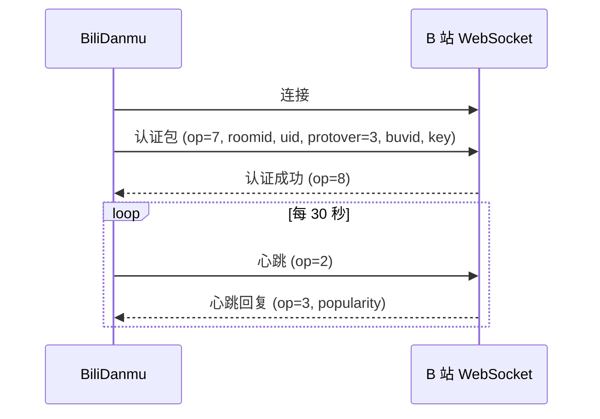

# 技术调研

本章记录 BiliDanmu 开发过程中的技术调研与方案选型。

## 弹幕协议调研

### B 站 WebSocket 弹幕协议

B 站直播弹幕基于 WebSocket 协议，使用自定义二进制帧格式：

- **包头**：16 字节，包含包长度、协议版本、操作码、序列号
- **包体**：JSON、Brotli 或 zlib 压缩数据
- **操作码**：
  - `2`：心跳
  - `3`：心跳回复（前 4 字节大端序为人气值）
  - `5`：业务消息（弹幕、礼物等）
  - `7`：认证
  - `8`：认证回复

### 认证流程

### 数据压缩

| 协议版本 | 说明 |
| --- | --- |
| 0 | 纯 JSON |
| 1 | 人气值（心跳回复） |
| 2 | zlib 压缩，内部可能嵌套多个包 |
| 3 | Brotli 压缩，内部可能嵌套多个包 |

BiliDanmu 请求 `protover=3`，并递归解析嵌套包。

### 消息类型

| 消息类型 | 说明 |
| --- | --- |
| `DANMU_MSG*` | 普通弹幕（前綴匹配，存在多种变体） |
| `SEND_GIFT` / `SEND_GIFT_V2` | 礼物（后者为 protobuf 载荷） |
| `INTERACT_WORD` / `INTERACT_WORD_V2` | 进场 |
| `SUPER_CHAT_MESSAGE` / `_JPN` | 醒目留言（JPN 为翻译变体） |
| `GUARD_BUY` | 上舰 |
| `LIKE_INFO_V3_CLICK` | 点赞 |
| `LIVE` / `PREPARING*` | 开播 / 下播 |

> **踩坑记录**：没有 `STOP_LIVE` 这个"当前房间下播"命令。`STOP_LIVE_ROOM_LIST` 是全站下播房间广播（`data.room_id_list` 列出其他房间），曾按前缀裸匹配导致正常直播间误报"下播了"。现在只在列表里包含本房间时才判定下播。

### protobuf 载荷

新版礼物消息 `SEND_GIFT_V2` 的 `data` 字段是 protobuf 二进制。项目没有引入完整的 protobuf 运行时，而是在 `src-tauri/src/bili/pb.rs` 实现了一个最小 wire 解码器（varint / length-delimited / fixed32 / fixed64），字段语义参考社区逆向的 `.proto` 定义与 JLiverTool 的实现。

## 直播流调研

### 流格式

| 格式 | 说明 | 支持情况 |
| --- | --- | --- |
| FLV | 传统格式，广泛支持 | ✅ 本项目使用 |
| TS | HLS 切片 | 兼容解析 |
| fMP4 | 基于 MSE 播放 | 兼容解析 |

### 播放方案

| 方案 | 优点 | 缺点 |
| --- | --- | --- |
| video.js | 成熟 | 体积大 |
| hls.js | HLS 专用 | 仅支持 HLS |
| mpegts.js | FLV/TS/fMP4 全支持 | 维护一般 |

BiliDanmu 选择 **mpegts.js** 播放直播音频（FLV → fMP4 → MSE）。

听视频则完全不需要解码器：直接解析 DASH 音轨地址，交给本地代理做 Range/206 直通，前端用原生 `<audio>` 播放。

## 语音识别调研

### 方案对比

| 方案 | 优点 | 缺点 |
| --- | --- | --- |
| sherpa-onnx | 本地、跨平台、流式 | 模型体积较大 |
| Whisper | 准确率高 | 体积大、速度慢、非流式 |
| 云端 API | 准确率高 | 需联网、隐私风险 |

BiliDanmu 选择 **sherpa-onnx 1.13**，兼顾本地推理与流式识别。

## 桌面框架调研

### 方案对比

| 框架 | 优点 | 缺点 |
| --- | --- | --- |
| Tauri 2 | 轻量、原生、安全 | Rust 学习曲线 |
| Electron | 成熟、生态好 | 体积大、内存高 |
| Flutter Desktop | 跨平台一致 | 生态较新 |

BiliDanmu 选择 **Tauri 2**，追求轻量与原生体验。

### 窗口吸附实现调研

Windows 上做"贴边收起"有几种做法：

| 方案 | 问题 |
| --- | --- |
| WebView 内监听 `mouseenter`/`mouseleave` | 点击穿透期间（`WS_EX_TRANSPARENT`）WebView 收不到任何鼠标消息 |
| 定时查询窗口几何 + 前端判定 | 需要跨 IPC 高频调用，抖动明显 |
| **Rust 侧全局光标轮询 + 直接改窗口几何** | 本项目采用：50ms 轮询（空闲态 100ms），状态机 `normal → collapsed → expanded → collapsing` |

同一个轮询机制也被隐身模式复用：显示判定用窗口矩形，隐藏判定用向外扩 8px 的矩形，两个阈值之间形成滞回。

## 状态管理调研

### 方案对比

| 方案 | 优点 | 缺点 |
| --- | --- | --- |
| Zustand | 轻量、简单 | 功能较少 |
| Redux | 成熟、生态好 | 模板代码多 |
| Jotai | 原子化 | 学习曲线 |

BiliDanmu 选择 **Zustand 5**，轻量且足够满足需求。

## 数据持久化调研

| 方案 | 结论 |
| --- | --- |
| `localStorage` | 只用于纯前端偏好（缩放、分隔条比例、上次检查更新时间）；设置曾放这里，已迁移 |
| `tauri-plugin-store` | 账号凭证等需要独立文件的敏感数据 |
| **SQLite（rusqlite bundled）** | 设置、房间、表情、图片缓存、快捷消息、窗口几何——需要事务、批量查询与体积控制的数据 |

踩坑：`settings.json` 曾是旧版本的设置文件，现已废弃；真实设置在 SQLite 的 `app_metadata` 表里。

## 后续调研

- [ ] 弹幕渲染性能进一步优化（Canvas / WebGL）
- [ ] 多平台细节打磨（macOS 签名公证、Linux 打包体积）
- [ ] 插件系统
